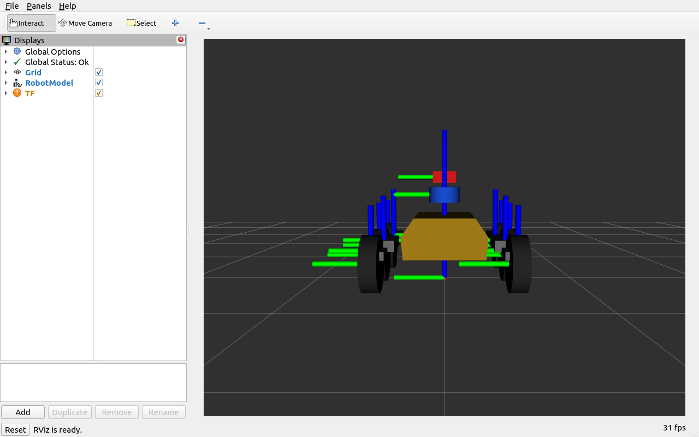
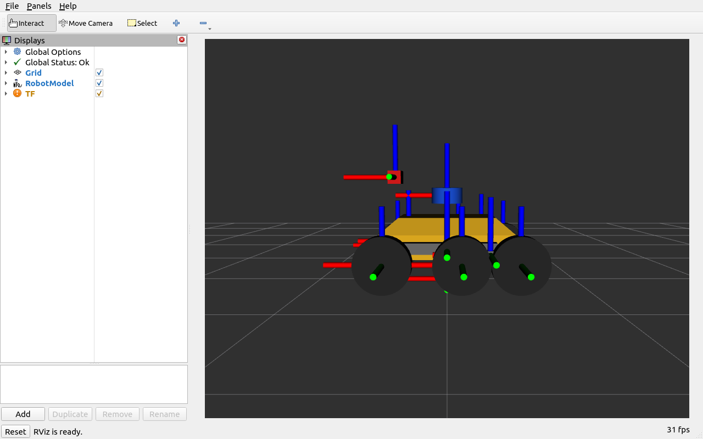

# urdf rover test

mars rover style 6-wheel rover with rocker bogie suspension arms.
first time using an stl mesh for visual geometry instead of just primitive boxes.

features:
- 6 drive wheels
- rocker and bogie links on left and right sides
- custom binary stl body (`meshes/chassis.stl`)
- sensor frames for camera, imu, and lidar

how to launch in rviz:
```bash
ros2 launch launch/display.launch.py
```

screenshots:


